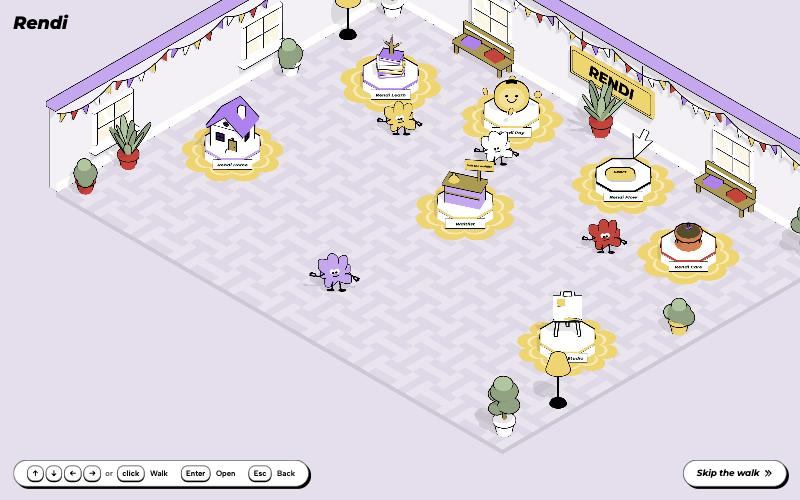
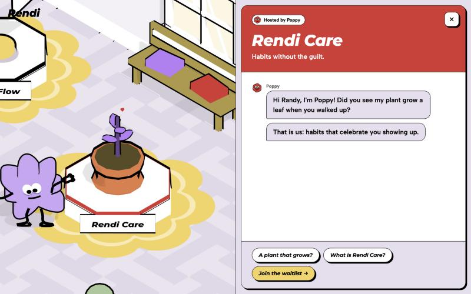

# Rendi Hall

An interactive isometric town for **Rendi** — *Most apps make you guess. We make it click.*
Walk Randy around a cozy Stardew-style town: About, How we work, News and the Post office (waitlist) each open a chat.
Step through the door under the **PRODUCTS** sign into an IT museum where every product is an app-window vitrine on the wall.
Bonus: catch all 8 bugs crawling around to ship v1.0 🚀 (a minimap in the corner helps).




> Concept prototype for a pitch. Products and copy are placeholders; there is no backend.

## Controls

| | |
|---|---|
| Arrows / WASD | walk |
| Click / tap the floor | walk there |
| Click a vitrine | walk to it and open |
| Click the minimap | walk there (town) |
| Walk into the PRODUCTS door / the ← Town mat | switch between town and hall |
| Enter / Space / E | open the nearest place or vitrine |
| Esc | close |
| **Skip the walk** | jump straight to any product |

Deep links: `#/product/learn` · `pay` · `flow` · `care` · `home` · `studio` · `#/place/about` · `how` · `news` · `waitlist`.

## Run locally

Safe to run: no backend, no network calls, install scripts disabled, dev server bound to localhost — see [SECURITY.md](SECURITY.md).

```bash
npm ci
npm run dev
```

`npm test` runs the logic tests (movement, proximity, camera framing, app state, chat graphs), `npm run build` outputs a static site to `dist/`.

## Deploy

Push to `main` on GitHub, then in **Settings → Pages** set *Source* to **GitHub Actions**. The workflow in `.github/workflows/pages.yml` tests, builds and publishes. The build uses a relative base, so any repo name works.

## How it's built

- three.js with an orthographic true-isometric camera, GSAP for camera and panel choreography, Vite, vanilla ES modules.
- One toon kit (`src/kit/toon.js`) gives everything the Rendi look: flat brand fills, 2-step shading, black inverted-hull outlines, hard shadows.
- Randy's body is the exact union of the five ellipses from the brand mascot SVG, extruded.
- One renderer: the product view is the live 3D scene zoomed onto the stand plus a DOM panel revealed with `clip-path`.
- Docs: [spec](docs/spec.md) · [system design](docs/system-design.md) · [ADRs](docs/adr/) · [plan](docs/superpowers/plans/2026-10-09-rendi-hall-prototype.md).

Brand colours and typography (Montserrat, Albert Sans) follow apprendi.io.
